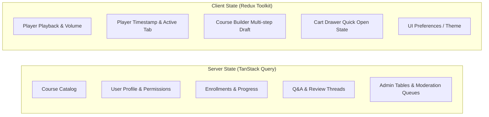

# SYSTEM ARCHITECTURE SPECIFICATION
## VTI Learning Marketplace & Enterprise LMS

---

## 1. ARCHITECTURAL VISION & GOALS
The VTI Marketplace LMS is engineered as a reusable, white-labelable, high-performance educational platform. It bridges the consumer marketplace dynamics of platforms like Udemy with the operational and compliance rigor of enterprise LMS solutions.

### Core Architecture Pillars:
1. **Separation of Concerns**: Unidirectional flow: Presentation (React Server/Client Components) → API Route Handlers → Authorization Middleware → Service Layer → Repository Layer → Database (Prisma / PostgreSQL).
2. **Server-Authoritative Business Logic**: Critical computations (pricing, discounts, enrollment states, quiz scores, progress tracking, certificate eligibility) must be computed and verified exclusively on the server.
3. **Pluggable Multi-Provider Adapters**: External dependencies (Payments, Object Storage, Email, WhatsApp, CDN) are isolated behind abstract interfaces, ensuring zero vendor lock-in.
4. **API-First & Mobile-Ready**: All marketplace, learning, and authoring capabilities are exposed via a structured REST API (`/api/v1/`), allowing identical backend reuse for native mobile applications.

---

## 2. HIGH-LEVEL SYSTEM TOPOLOGY

```mermaid
flowchart TD
    subgraph Clients["Client Layer"]
        Web[Next.js Web Client\nReact Server/Client Components]
        Mobile[Future Mobile Client\nReact Native / iOS / Android]
    end

    subgraph Gateway["Edge & Gateway Layer"]
        Middleware[Next.js Middleware\nSession Check, Route Guards, CORS, Rate Limit]
    end

    subgraph APILayer["API Route Handlers (/api/v1/)"]
        AuthRoutes[/auth]
        CourseRoutes[/courses]
        CartRoutes[/cart & /checkout]
        LearningRoutes[/learning & /player]
        AdminRoutes[/admin]
    end

    subgraph ServiceLayer["Core Domain Services"]
        AuthService[Auth & RBAC Service]
        PricingService[Authoritative Pricing Engine]
        CourseService[Course & Taxonomy Service]
        LearningService[Enrollment & Progress Engine]
        AssessmentService[Quiz & Grading Engine]
        PaymentService[Payment Orchestrator]
        NotificationService[Notification Dispatcher]
    end

    subgraph Adapters["Infrastructure Adapters"]
        StorageAdapter[Storage Provider\nLocal / S3 / R2]
        PaymentAdapter[Payment Provider\nStripe / PayPal / Razorpay]
        EmailAdapter[Email Provider\nSMTP / Resend / SES]
    end

    subgraph Persistence["Data & Storage Layer"]
        Postgres[(PostgreSQL Database\nPrisma ORM)]
        ObjectStore[(Object Storage / S3 / CDN)]
    end

    Clients --> Middleware
    Middleware --> APILayer
    APILayer --> ServiceLayer
    ServiceLayer --> Adapters
    ServiceLayer --> Postgres
    Adapters --> ObjectStore
```

---

## 3. APPLICATION DIRECTORY STRUCTURE

The application follows Next.js App Router standards with strict domain-driven modularity:

```
d:/VTI/
├── app/                            # Next.js App Router
│   ├── (public)/                   # Public marketplace route group
│   │   ├── page.tsx                # Homepage
│   │   ├── courses/                # Course catalog & search
│   │   │   ├── page.tsx
│   │   │   └── [slug]/page.tsx     # Course landing page
│   │   ├── categories/[slug]/      # Category landing page
│   │   ├── cart/page.tsx           # Shopping cart
│   │   ├── checkout/page.tsx       # Checkout experience
│   │   ├── login/page.tsx          # Login
│   │   ├── signup/page.tsx         # Signup
│   │   └── verify/[id]/page.tsx    # Public certificate verification
│   ├── (student)/                  # Student protected portal
│   │   └── student/
│   │       ├── dashboard/page.tsx  # Student dashboard
│   │       ├── learning/page.tsx   # My Learning
│   │       ├── course/[id]/learn/  # Next-Gen Course Player
│   │       ├── certificates/       # My Certificates
│   │       └── settings/           # Account settings
│   ├── (instructor)/               # Instructor Studio portal
│   │   └── instructor/
│   │       ├── dashboard/page.tsx  # Instructor analytics
│   │       ├── courses/            # Course management
│   │       │   ├── page.tsx
│   │       │   └── [id]/manage/    # Guided Course Builder Wizard
│   │       ├── communications/     # Q&A & Announcements
│   │       └── earnings/           # Revenue & payouts
│   ├── (admin)/                    # Admin & Operations portal
│   │   └── admin/
│   │       ├── dashboard/page.tsx  # Operational analytics
│   │       ├── courses/            # Course moderation queue
│   │       ├── users/              # Students, Instructors, Admins
│   │       ├── deletion-requests/  # Deletion workflow queue
│   │       ├── orders/             # Orders, Payments, Refunds
│   │       ├── settings/           # Platform & Feature flags
│   │       └── audit-logs/         # System audit trails
│   ├── api/v1/                     # Versioned REST API routes
│   │   ├── auth/
│   │   ├── courses/
│   │   ├── cart/
│   │   ├── checkout/
│   │   ├── webhooks/
│   │   ├── learning/
│   │   ├── instructor/
│   │   └── admin/
│   ├── layout.tsx                  # Root layout
│   └── globals.css                 # Global Tailwind styles & tokens
├── src/
│   ├── components/                 # UI components
│   │   ├── ui/                     # Primitives (shadcn/ui + Tailwind)
│   │   ├── marketplace/            # Header, CourseCard, Filters, StickyBuy
│   │   ├── player/                 # VideoPlayer, NotesTab, QATab, CurriculumDrawer
│   │   ├── course-builder/         # Drag-and-drop Curriculum, StageWizard
│   │   └── shared/                 # DataTables, EmptyStates, ModalDialogs
│   ├── lib/                        # Core utilities & singleton clients
│   │   ├── prisma.ts               # Prisma Client singleton
│   │   ├── redis.ts                # Cache/Rate-limit client (optional/mockable)
│   │   └── utils.ts                # General helpers
│   ├── server/                     # Server-only logic
│   │   ├── api/                    # API Response helpers & error handler
│   │   ├── auth/                   # Session verification & RBAC guard
│   │   ├── services/               # Business logic domain services
│   │   │   ├── auth.service.ts
│   │   │   ├── pricing.service.ts
│   │   │   ├── course.service.ts
│   │   │   ├── enrollment.service.ts
│   │   │   ├── quiz.service.ts
│   │   │   ├── certificate.service.ts
│   │   │   └── audit.service.ts
│   │   └── adapters/               # Third-party service adapters
│   │       ├── payment/            # Stripe, PayPal, Mock
│   │       ├── storage/            # Local, S3, R2
│   │       └── email/              # Resend, SMTP, Mock
│   ├── store/                      # Redux Toolkit store (client-only state)
│   │   ├── index.ts
│   │   ├── cartSlice.ts
│   │   ├── playerSlice.ts
│   │   └── courseWizardSlice.ts
│   └── types/                      # Shared TypeScript contracts & schemas
├── prisma/
│   ├── schema.prisma               # Modular Prisma schema
│   ├── migrations/                 # PostgreSQL migrations
│   └── seed.ts                     # Comprehensive development seed fixtures
├── docs/                           # Living project documentation
└── public/                         # Static assets
```

---

## 4. STATE MANAGEMENT ARCHITECTURE



- **TanStack Query Rules**:
  - Handles 100% of data fetched from `/api/v1/`.
  - Configured with stale-time policies (e.g., 5 minutes for course taxonomy, 0 minutes for checkout/orders).
  - Handles automatic query invalidation upon mutations (e.g., submitting a review invalidates `['course-reviews', courseId]`).
- **Redux Toolkit Rules**:
  - Reserved strictly for transient or offline-capable UI state that does not belong on the server.
  - Zero duplication of server cache inside Redux.

---

## 5. SECURITY & AUTHORIZATION ARCHITECTURE

### Centralized Role-Based Access Control (RBAC):
- Roles: `SUPER_ADMIN`, `ADMIN`, `INSTRUCTOR`, `STUDENT`.
- Granular Permissions:
  - `courses.create`, `courses.edit`, `courses.publish`, `courses.moderate`
  - `students.view`, `students.suspend`, `instructors.assign`
  - `orders.view`, `refunds.manage`, `audit.view`, `settings.manage`
- Permission Evaluation:
  ```typescript
  // Canonical check pattern in services and route handlers:
  await requirePermission(session.user, 'courses.moderate');
  await requireCourseOwnership(session.user, courseId);
  ```

### Two-Person Integrity for Destructive Actions:
- `ADMIN` role cannot hard-delete users, courses, or financial records.
- Deletions create a `DeletionRequest` record with reason and entity metadata.
- `SUPER_ADMIN` evaluates, approves, or rejects the request, generating an immutable `AuditLog`.

### Media Delivery Security:
- High-value media (video streams, solution sheets, course attachments) are served via presigned URLs with short expiry times (e.g., 15 minutes).
- Public preview video clips are served with public read permissions.
- Direct PostgreSQL storage of raw media blobs is strictly prohibited.
