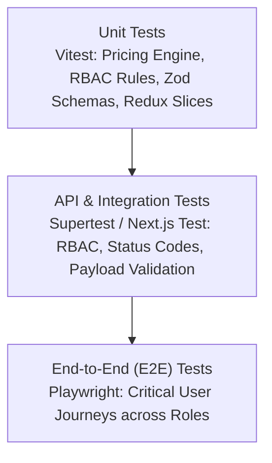

# QUALITY ASSURANCE & TESTING STRATEGY
## VTI Marketplace LMS Verification Framework

---

## 1. QUALITY PHILOSOPHY
In accordance with Section 60 and 64 of the specification:
- A feature is **never** considered complete simply because a page renders, a button appears, or an endpoint returns a static 200 OK.
- No fake implementations, no stubbed `TODO` placeholders presented as complete, and no hard-coded fake analytics.
- Every subsystem must adhere to the **Definition of Done (DoD)**:
  `Database + Business Logic + API + Authorization + UI + Validation + Error Handling + Mobile + Testing + Security = Done`.

---

## 2. TESTING PYRAMID & SCOPE

### Layer 1: Unit Testing (Vitest)
- **Target**: Isolated business logic without network or database overhead.
- **Coverage Areas**:
  - `PricingService`: Base price, fixed/percentage coupons, min spend thresholds, minor unit calculations, tax deductions.
  - `RBAC Evaluator`: Role permission resolution, resource ownership validation.
  - `Zod Validation Schemas`: Request body validation for all mutations.
  - `Redux Slices`: Cart local manipulation, player playback tracking state, course builder draft wizard state.

### Layer 2: API & Integration Testing (Supertest / Route Testing)
- **Target**: Next.js Route Handlers (`/api/v1/*`) with active database transactions.
- **Coverage Areas**:
  - Authentication flow (signup, login, cookie persistence, session invalidation).
  - RBAC route protection (401 Unauthorized for unauthenticated, 403 Forbidden for insufficient permissions).
  - Deletion request workflow (Admin request submission → Super Admin approval → entity removal).
  - Webhook processing (cryptographic signature verification, idempotency handling, automatic enrollment generation).
  - Quiz grading engine (server-side score computation, answer protection).
  - Certificate issuance (automatic issuance at 100% completion, duplicate award prevention).

### Layer 3: End-to-End (E2E) Testing (Playwright)
- **Target**: Browser automation testing complete user journeys across mobile and desktop viewports.
- **Critical Mandatory E2E Journeys (from Section 59 of the Specification)**:
  1. **Student Complete Journey**:
     `Browse Catalog → Search with Filter → View Course Landing Page → Watch Preview Lecture → Add to Cart → Apply Coupon → Checkout → Mock/Stripe Payment → Auto-Enrollment → Enter Course Player → Stream Video & Heartbeat Auto-Save → Take Timestamped Note → Complete Lessons → Submit Quiz → Receive Certificate → Verify at /verify/[id] → Leave Course Review`.
  2. **Instructor Authoring Journey**:
     `Instructor Login → Dashboard → Create Course → Complete Guided Stages → Drag-and-drop Curriculum Sections & Lessons → Upload Thumbnail & Video → Set Pricing → Run Validation → Submit Course for Review`.
  3. **Admin Moderation & Governance Journey**:
     `Admin Login → Moderation Queue → Inspect Submitted Course → Request Changes / Approve → Course transitions to PUBLISHED on Public Marketplace`.
  4. **Deletion Governance Journey**:
     `Admin requests entity deletion with reason → Super Admin inspects Deletion Queue → Super Admin approves → Entity removed → Immutable Audit Log recorded`.

---

## 3. SECURITY & COMPLIANCE VERIFICATION
1. **Server-Authoritative Enforcement**:
   - Zero client-side trust for prices, roles, enrollments, quiz scores, or certificate statuses.
   - All mutation endpoints strictly validated against authenticated session and resource ownership.
2. **Media Protection**:
   - Private course videos, PDFs, and resources served strictly via presigned, time-limited URLs.
3. **Data Integrity & Immutability**:
   - Historical financial transactions, orders, and certificates must never be hard-deleted upon user deletion requests.
4. **Automated Security Scans**:
   - Continuous dependency auditing (`npm audit`).
   - OWASP Top 10 mitigation verification (XSS, CSRF, SQL Injection, broken access control).

---

## 4. RESPONSIVE & ACCESSIBILITY AUDIT CRITERIA
- **Device Viewports**:
  - Mobile: 375px × 667px (iPhone SE) & 390px × 844px (iPhone 13/14)
  - Tablet: 768px × 1024px (iPad)
  - Desktop: 1440px × 900px
- **Accessibility Standard**: Target WCAG 2.1 AA compliance:
  - Accessible contrast ratios (minimum 4.5:1 for normal text).
  - Full keyboard navigability (visible focus indicators, tab navigation).
  - Meaningful ARIA roles on dialogs, drawers, dropdowns, and video controls.
