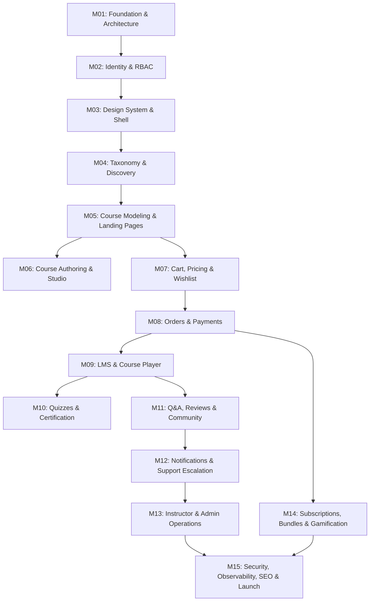

# MASTER ROADMAP & SESSION-SIZED TASK SPECIFICATION
## VTI Marketplace LMS Execution Plan

---

## 1. ROADMAP OVERVIEW & SESSION STRATEGY
This roadmap partitions the entire 79-page VTI Marketplace LMS specification into **15 logically bounded Milestones**, further decomposed into **session-sized tasks**.

Each sub-milestone is engineered to:
- Be executable within a single, focused AI coding session.
- Guarantee strict dependency ordering (zero forward references).
- Deliver a functional, testable vertical slice (Database + Service + API + UI + Automated Tests).
- Maintain repository integrity and persistent state across AI context restarts.

---

## MILESTONE 1: PROJECT FOUNDATION & ARCHITECTURE INFRASTRUCTURE
*Estimated Sessions: 1–2*

### Sub-Milestone 1.1: Next.js Foundation, Tooling & Design System Setup
- **Objective**: Establish the core Next.js 15+ App Router application with TypeScript, Tailwind CSS, Lucide icons, and base shadcn/ui primitives.
- **Why Needed**: Provides the build system, type-safety, and design tokens for all future UI pages.
- **PDF Sections Covered**: Section 0, 53, 54, 65.
- **Dependencies**: None (Greenfield).
- **Files Affected**: `package.json`, `tsconfig.json`, `tailwind.config.ts`, `app/globals.css`, `app/layout.tsx`, `src/lib/utils.ts`.
- **Testing**: Next.js build validation (`npm run build`), linting check (`npm run lint`).
- **Acceptance Criteria**: App runs cleanly on `localhost:3000` with zero console errors and full TypeScript compilation.

### Sub-Milestone 1.2: Database Engine & Prisma Modular Setup
- **Objective**: Configure PostgreSQL connection, initial Prisma schema setup, client singleton, and database migration scripts.
- **Why Needed**: Persists all core platform state and enforces database relational integrity.
- **PDF Sections Covered**: Section 5, 46, 48.
- **Dependencies**: Sub-Milestone 1.1.
- **Files Affected**: `prisma/schema.prisma`, `src/lib/prisma.ts`, `.env.example`.
- **Testing**: Prisma format, validation (`npx prisma validate`), and test migration execution.
- **Acceptance Criteria**: Prisma client generates successfully with strongly typed models.

### Sub-Milestone 1.3: Core Architecture Services & Standard API Utilities
- **Objective**: Implement base HTTP response wrapper (`ApiResponse<T>`), standardized error handlers, structured request logging middleware, and repository base interfaces.
- **Why Needed**: Ensures consistent error handling, security, and developer productivity across all subsequent API endpoints.
- **PDF Sections Covered**: Section 49, 50, 58, 59.
- **Dependencies**: Sub-Milestone 1.1, 1.2.
- **Files Affected**: `src/server/api/response.ts`, `src/server/api/errors.ts`, `src/server/api/logger.ts`.
- **Testing**: Unit tests for API response formatting and error mapping.
- **Acceptance Criteria**: Standardized JSON envelopes `{ success: boolean, data?: T, error?: { code, message } }` on all routes.

---

## MILESTONE 2: IDENTITY, RBAC & CORE AUTHENTICATION
*Estimated Sessions: 2*

### Sub-Milestone 2.1: Authentication Domain & Session Management
- **Objective**: Implement secure cookie-based session management, password hashing (Argon2id/bcrypt), user registration (Student), and login/logout flows.
- **Why Needed**: Foundational identity needed for student enrollments, instructor management, and admin governance.
- **PDF Sections Covered**: Section 4, 7, 8, 44, 46, 50.
- **Dependencies**: Milestone 1.
- **Database Changes**: `User`, `Session`, `StudentProfile`, `InstructorProfile`.
- **API Endpoints**: `POST /api/v1/auth/signup`, `POST /api/v1/auth/login`, `POST /api/v1/auth/logout`, `GET /api/v1/auth/me`.
- **Testing**: Unit tests for password hashing; API tests for signup, invalid password, session cookie issuance, and logout revocation.
- **Acceptance Criteria**: Secure HTTP-only cookie authentication working seamlessly across client and server components.

### Sub-Milestone 2.2: Centralized RBAC & Permission Service
- **Objective**: Implement role hierarchies (`SUPER_ADMIN`, `ADMIN`, `INSTRUCTOR`, `STUDENT`) and granular permission checks (`requirePermission('courses.publish')`).
- **Why Needed**: Protects sensitive instructor and administrative routes without scattered, fragile `if (user.role === 'ADMIN')` code.
- **PDF Sections Covered**: Section 4, 5, 6, 7, 50.
- **Files Affected**: `src/server/auth/rbac.ts`, `src/middleware.ts`, `prisma/schema.prisma` (`Permission`, `UserPermission`).
- **Testing**: Test suite verifying unauthorized (401) and forbidden (403) access across role combinations.
- **Acceptance Criteria**: Non-admin users are strictly blocked from admin routes both at edge middleware and service layers.

### Sub-Milestone 2.3: Admin Deletion Request Workflow & Audit Logging
- **Objective**: Implement the two-person deletion workflow (Admin requests -> Super Admin approves/rejects) and automated audit logging engine.
- **Why Needed**: Prevents unilateral data loss and complies with financial and institutional audit requirements.
- **PDF Sections Covered**: Section 7, 11, 51, 70.
- **Database Changes**: `DeletionRequest`, `AuditLog`.
- **API Endpoints**: `POST /api/v1/admin/deletions/request`, `POST /api/v1/admin/deletions/:id/decide`, `GET /api/v1/admin/audit-logs`.
- **Testing**: Automated integration tests verifying deletion request creation, approval, and audit trail record generation.
- **Acceptance Criteria**: Deletions cannot execute without Super Admin decision record.

---

## MILESTONE 3: DESIGN SYSTEM, LAYOUTS & PUBLIC SHELL
*Estimated Sessions: 1–2*

### Sub-Milestone 3.1: Global Responsive Layouts & Navigation Shells
- **Objective**: Build responsive header, mobile navigation drawer, and distinct layout wrappers for: Public Marketplace, Student Portal, Instructor Studio, and Admin Operations.
- **Why Needed**: Establishes standard UX shell for all user types across desktop, tablet, and mobile.
- **PDF Sections Covered**: Section 10, 43, 44, 45, 46, 47, 52, 53, 54.
- **Dependencies**: Milestone 1, 2.
- **Files Affected**: `src/components/layout/Navbar.tsx`, `src/components/layout/MobileNav.tsx`, `app/(public)/layout.tsx`, `app/(student)/layout.tsx`, `app/(admin)/layout.tsx`.
- **Testing**: Responsive visual validation on mobile viewport (375px), tablet (768px), desktop (1440px).
- **Acceptance Criteria**: Clean, mobile-friendly navigation with active role-based link visibility.

### Sub-Milestone 3.2: Reusable UI Component Primitives & Feedback States
- **Objective**: Implement reusable buttons, inputs, modals, data tables, empty states, skeleton loaders, and error boundaries.
- **Why Needed**: Ensures UI consistency, prevents page-by-page styling drift, and complies with Section 53/54.
- **PDF Sections Covered**: Section 53, 54.
- **Files Affected**: `src/components/ui/*`, `src/components/shared/EmptyState.tsx`, `src/components/shared/LoadingSkeleton.tsx`.
- **Testing**: Component unit tests and accessibility checks (axe-core).
- **Acceptance Criteria**: Every UI primitive supports loading, empty, disabled, and error states.

### Sub-Milestone 3.3: CMS-Lite & Platform Configuration Engine
- **Objective**: Implement `SiteSetting` key-value configuration system for dynamic homepage banners, logos, platform statistics, and feature flags.
- **Why Needed**: Allows white-labeling and rebranding without modifying source code.
- **PDF Sections Covered**: Section 42, 43, 66, 67.
- **Database Changes**: `SiteSetting`.
- **API Endpoints**: `GET /api/v1/settings/public`, `PATCH /api/v1/admin/settings`.
- **Testing**: Setting retrieval and modification integration tests.
- **Acceptance Criteria**: Public marketplace displays branding dynamically from database settings.

---

## MILESTONE 4: MARKETPLACE TAXONOMY & COURSE DISCOVERY
*Estimated Sessions: 2*

### Sub-Milestone 4.1: Hierarchical Taxonomy Engine
- **Objective**: Implement 3-tier taxonomy (Category → Subcategory → Topic) with administrative management APIs and public navigation tree.
- **Why Needed**: Structure course catalog discovery and SEO categorization.
- **PDF Sections Covered**: Section 12, 16, 17, 42.
- **Database Changes**: `Category`, `Subcategory`, `Topic`.
- **API Endpoints**: `GET /api/v1/categories`, `POST /api/v1/admin/categories`, `POST /api/v1/admin/subcategories`, `POST /api/v1/admin/topics`.
- **Testing**: Hierarchy relational tests; cascade delete rules.
- **Acceptance Criteria**: Categories cleanly nest and render on marketplace navigation header.

### Sub-Milestone 4.2: Course Search & Multi-Faceted Filter Service
- **Objective**: Implement `CourseSearchService` supporting text search, multi-faceted filtering (category, price, rating, level, duration), and sorting (Relevance, Highest Rated, Newest, Price).
- **Why Needed**: Enables instant, scalable course discovery without hardcoded frontend logic.
- **PDF Sections Covered**: Section 10, 11, 15, 16, 37.
- **API Endpoints**: `GET /api/v1/courses/search?q=&category=&level=&sort=`.
- **Testing**: Filter matrix unit tests with varied query params; edge case tests for zero results.
- **Acceptance Criteria**: Accurate search results returned in <100ms with pagination and facet counts.

### Sub-Milestone 4.3: Public Marketplace Homepage & Discovery UI
- **Objective**: Build the public marketplace homepage featuring Hero banner, Popular Categories, Featured Courses, Trending Courses, and Search Catalog view with responsive filter drawer.
- **Why Needed**: Primary landing surface for visitors and prospective students.
- **PDF Sections Covered**: Section 10, 11, 41, 42, 43, 52.
- **Files Affected**: `app/(public)/page.tsx`, `app/(public)/courses/page.tsx`, `src/components/marketplace/CourseFilterDrawer.tsx`.
- **Testing**: UI interaction tests for filter application and search input debounce.
- **Acceptance Criteria**: Responsive catalog page with instant filter updates via TanStack Query.

---

## MILESTONE 5: COURSE MODELING & PUBLIC LANDING PAGES
*Estimated Sessions: 2*

### Sub-Milestone 5.1: Course Data Model & Instructor Relations
- **Objective**: Implement full `Course` schema with pricing, learning outcomes, requirements, intended learners, curriculum relations, and multi-instructor co-teaching support.
- **Why Needed**: Forms the core content asset model of the entire marketplace.
- **PDF Sections Covered**: Section 9, 13, 14, 18, 30.
- **Database Changes**: `Course`, `CourseInstructor`.
- **API Endpoints**: `GET /api/v1/courses/:slug`, `GET /api/v1/instructors/:id/courses`.
- **Testing**: Model validation tests for integer minor prices, slug uniqueness, and cascade integrity.
- **Acceptance Criteria**: Complete course model with all descriptive metadata queryable via Prisma.

### Sub-Milestone 5.2: Public Course Landing Page (Above the Fold & Sidebar)
- **Objective**: Build premium course landing page above-the-fold hero, title, subtitle, ratings summary, instructor card, and sticky pricing/enrollment widget.
- **Why Needed**: High-conversion landing experience equivalent to industry leaders like Udemy.
- **PDF Sections Covered**: Section 13, 14, 15, 17, 18, 77.
- **Files Affected**: `app/(public)/courses/[slug]/page.tsx`, `src/components/course/StickyEnrollCard.tsx`.
- **Testing**: Responsive layout tests, video preview modal launch test.
- **Acceptance Criteria**: Sticky purchase card sticks properly on desktop scroll and transforms to bottom bar on mobile.

### Sub-Milestone 5.3: Course Landing Page (Curriculum Accordion & Details)
- **Objective**: Implement "What you'll learn", requirements, collapsible curriculum accordion (sections & lectures with duration and preview tags), and instructor bio section.
- **Why Needed**: Provides students with all necessary information to make a purchasing decision.
- **PDF Sections Covered**: Section 13, 14, 15, 18, 31.
- **Files Affected**: `src/components/course/CurriculumAccordion.tsx`, `src/components/course/InstructorBioCard.tsx`.
- **Testing**: Accordion toggle tests, preview lecture launch modal test.
- **Acceptance Criteria**: Non-enrolled users can view full curriculum list and watch designated preview lectures only.

---

## MILESTONE 6: INSTRUCTOR STUDIO & COURSE AUTHORING ENGINE
*Estimated Sessions: 3*

### Sub-Milestone 6.1: Instructor Studio Dashboard & Course Catalog List
- **Objective**: Build instructor portal shell, course listing table with draft/published status badges, and "Create Course" trigger.
- **Why Needed**: Gateway for educators to create and manage their course inventory.
- **PDF Sections Covered**: Section 8, 12, 13, 31, 33, 44, 46.
- **API Endpoints**: `GET /api/v1/instructor/courses`, `POST /api/v1/instructor/courses`.
- **Files Affected**: `app/(instructor)/instructor/dashboard/page.tsx`, `app/(instructor)/instructor/courses/page.tsx`.
- **Testing**: Instructor course list filtering and course creation initiation tests.
- **Acceptance Criteria**: Instructors can only view and manage courses they own or co-instruct.

### Sub-Milestone 6.2: Guided Multi-Stage Course Builder Wizard
- **Objective**: Implement 16-stage course builder wizard (Planning, Basic Info, Intended Learners, Landing Page Details, Pricing) with Redux drafting state and server autosave.
- **Why Needed**: Guides instructors systematically through comprehensive course creation without losing progress.
- **PDF Sections Covered**: Section 13, 33, 34.
- **Files Affected**: `src/components/course-builder/WizardNav.tsx`, `src/components/course-builder/stages/*`.
- **Testing**: Step navigation, input validation, and stage completion indicator tests.
- **Acceptance Criteria**: Step progress persisted automatically; visual indicators show complete/incomplete steps.

### Sub-Milestone 6.3: Interactive Curriculum Builder
- **Objective**: Implement drag-and-drop section and lecture builder supporting multiple lesson types (Video, Article, PDF, Quiz) with inline editing.
- **Why Needed**: Empowers instructors to organize and structure comprehensive multi-module courses easily.
- **PDF Sections Covered**: Section 14, 19, 33.
- **Database Changes**: `Section`, `Lesson`.
- **API Endpoints**: `POST /api/v1/instructor/courses/:id/sections`, `POST /api/v1/instructor/courses/:id/lessons`, `PATCH /api/v1/instructor/courses/:id/reorder`.
- **Testing**: Section reordering tests; lecture addition and deletion tests.
- **Acceptance Criteria**: Instructors can dynamically add, delete, edit, and reorder sections and lectures with immediate persistence.

### Sub-Milestone 6.4: Media Upload & Asset Management Service
- **Objective**: Implement upload service with file type validation, chunked upload support, signed URL generation, and storage provider adapter (Local Disk for dev, S3/R2 for prod).
- **Why Needed**: Securely handles video lectures, lesson PDFs, and course thumbnails without overloading database.
- **PDF Sections Covered**: Section 15, 20, 50, 52.
- **Files Affected**: `src/server/adapters/storage/*`, `src/server/services/upload.service.ts`, `app/api/v1/uploads/route.ts`.
- **Testing**: File size limit validation, MIME type checks, signed upload URL retrieval tests.
- **Acceptance Criteria**: Uploaded videos/files stored securely; media URLs strictly signed and authorized.

### Sub-Milestone 6.5: Course Moderation Workflow & Publication Lifecycle
- **Objective**: Implement course submission, pre-publish validation checks, moderation queue for Admins, and approval/rejection with feedback.
- **Why Needed**: Enforces course quality and compliance before public marketplace availability.
- **PDF Sections Covered**: Section 33, 34, 35, 60.
- **Database Changes**: `ModerationLog`.
- **API Endpoints**: `POST /api/v1/instructor/courses/:id/submit`, `POST /api/v1/admin/courses/:id/moderate`.
- **Testing**: Course validation rules (requires at least 1 section, 1 video, pricing, landing page before submission); Admin approval integration test.
- **Acceptance Criteria**: Only courses approved by Admin transition to `PUBLISHED` status and appear on marketplace.

---

## MILESTONE 7: CART, WISHLIST, COUPONS & PRICING ENGINE
*Estimated Sessions: 2*

### Sub-Milestone 7.1: Authoritative Server Pricing Engine
- **Objective**: Build centralized `PricingService` computing Base Price → Promotional Discount → Coupon Deduction → Tax → Final Minor Amount in integer units.
- **Why Needed**: Ensures zero client-side price tampering or inconsistent discounts across UI components.
- **PDF Sections Covered**: Section 21, 23, 24, 73, 74.
- **Files Affected**: `src/server/services/pricing.service.ts`.
- **Testing**: Unit tests covering fixed/percent coupons, minimum spends, currency conversion, and tax calculations.
- **Acceptance Criteria**: Pure server-side price computation returning breakdown `{ subtotal, discount, tax, total, currency }`.

### Sub-Milestone 7.2: Persistent Shopping Cart Engine
- **Objective**: Build server-backed shopping cart with Redux client sync, supporting add/remove, save for later, duplicate enrollment detection, and already-owned course prevention.
- **Why Needed**: High-conversion multi-course checkout experience.
- **PDF Sections Covered**: Section 21, 25, 43.
- **Database Changes**: `Cart`, `CartItem`.
- **API Endpoints**: `GET /api/v1/cart`, `POST /api/v1/cart/items`, `DELETE /api/v1/cart/items/:id`.
- **Testing**: Already-enrolled course rejection test, multiple item addition test.
- **Acceptance Criteria**: Cart items persist across login sessions; enrolled courses cannot be added to cart.

### Sub-Milestone 7.3: Wishlist & Save-for-Later System
- **Objective**: Implement student wishlist with quick "Move to Cart" and persistent storage.
- **Why Needed**: Increases course retention and future purchases.
- **PDF Sections Covered**: Section 22, 25, 43.
- **Database Changes**: `WishlistItem`.
- **API Endpoints**: `GET /api/v1/wishlist`, `POST /api/v1/wishlist/:courseId`, `DELETE /api/v1/wishlist/:courseId`.
- **Testing**: Add to wishlist, move to cart atomicity tests.
- **Acceptance Criteria**: Students can toggle wishlist state from course cards and landing pages.

### Sub-Milestone 7.4: Coupon Management Engine
- **Objective**: Build Admin & Instructor coupon management engine supporting code generation, percentage/fixed discounts, usage limits, expiration dates, and validation APIs.
- **Why Needed**: Core marketing and promotion engine for marketplace campaigns.
- **PDF Sections Covered**: Section 23, 24, 26.
- **Database Changes**: `Coupon`.
- **API Endpoints**: `POST /api/v1/admin/coupons`, `POST /api/v1/coupons/validate`.
- **Testing**: Expired coupon rejection test; max usage limit enforcement test.
- **Acceptance Criteria**: Coupons applied server-side; invalid/expired coupons return human-readable rejection reasons.

---

## MILESTONE 8: ORDERS, CHECKOUT & PAYMENT GATEWAY INTEGRATION
*Estimated Sessions: 2*

### Sub-Milestone 8.1: Order Creation & Checkout Session
- **Objective**: Implement checkout initialization, order record generation with pending status, and order item snapshots in integer minor units.
- **Why Needed**: Formalizes the commercial transaction before initiating external payment provider sessions.
- **PDF Sections Covered**: Section 21, 25, 27, 47.
- **Database Changes**: `Order`, `OrderItem`.
- **API Endpoints**: `POST /api/v1/checkout/session`.
- **Testing**: Order generation test; order amount validation against pricing service.
- **Acceptance Criteria**: Pending order created with unique order number and exact breakdown snapshot.

### Sub-Milestone 8.2: Polymorphic Payment Provider Adapter (Stripe, PayPal, Mock)
- **Objective**: Implement `PaymentProvider` interface with Stripe adapter, PayPal adapter, and development Mock adapter.
- **Why Needed**: Decouples business logic from external payment APIs, enabling simple switching between payment providers.
- **PDF Sections Covered**: Section 25, 28, 64.
- **Files Affected**: `src/server/adapters/payment/*`.
- **Testing**: Mock adapter payment intent creation and signature verification unit tests.
- **Acceptance Criteria**: Zero direct Stripe/PayPal coupling in core application services.

### Sub-Milestone 8.3: Webhook Architecture, Idempotency & Auto-Enrollment
- **Objective**: Implement payment webhook handler with cryptographic signature verification, idempotency checking, payment recording, and atomic course enrollment.
- **Why Needed**: Guarantees courses are unlocked reliably even if student closes browser after payment.
- **PDF Sections Covered**: Section 25, 28, 50, 52, 78.
- **Database Changes**: `Payment`, `Enrollment`.
- **API Endpoints**: `POST /api/v1/webhooks/payments/:provider`.
- **Testing**: Webhook replay attack test; duplicate webhook idempotency test; automatic enrollment verification test.
- **Acceptance Criteria**: Webhooks processed exactly once in an ACID transaction; enrollment created immediately.

### Sub-Milestone 8.4: Configurable Refund Engine & Audit Trail
- **Objective**: Implement configurable refund policy engine supporting standard time-windows, completion-percentage threshold rules (VTI rule), and Admin refund approval.
- **Why Needed**: Protects business against refund abuse while complying with consumer rights.
- **PDF Sections Covered**: Section 26, 29, 51.
- **Database Changes**: `Refund`.
- **API Endpoints**: `POST /api/v1/orders/:id/refund-request`, `POST /api/v1/admin/refunds/:id/process`.
- **Testing**: Refund eligibility tests (e.g. course progress > 20% rejected under VTI rule); refund transaction test.
- **Acceptance Criteria**: Refunds revoke course access and record immutable audit logs.

---

## MILESTONE 9: LEARNING MANAGEMENT SYSTEM (LMS) & COURSE PLAYER
*Estimated Sessions: 3*

### Sub-Milestone 9.1: Student "My Learning" Portal & Enrollment Guards
- **Objective**: Build student dashboard with "Continue Learning" cards, enrolled courses grid, completion progress bars, and strict enrollment verification guards.
- **Why Needed**: Dedicated learning hub for enrolled students.
- **PDF Sections Covered**: Section 35, 43, 45, 50.
- **API Endpoints**: `GET /api/v1/student/enrollments`, `GET /api/v1/student/enrollments/:courseId`.
- **Files Affected**: `app/(student)/student/learning/page.tsx`, `src/components/student/CourseProgressCard.tsx`.
- **Testing**: Unenrolled student access rejection test; active enrollment fetching test.
- **Acceptance Criteria**: Students only access courses they have actively enrolled in or purchased.

### Sub-Milestone 9.2: Next-Gen Course Player Architecture
- **Objective**: Build modern course player with video playback, custom controls (speed 0.5x–2x, captions, fullscreen, pip, keyboard shortcuts), collapsible curriculum sidebar, and mobile drawer.
- **Why Needed**: Core daily learning interface for students.
- **PDF Sections Covered**: Section 16, 20, 21, 22, 52, 54.
- **Files Affected**: `app/(student)/student/course/[id]/learn/page.tsx`, `src/components/player/VideoPlayer.tsx`, `src/components/player/CurriculumSidebar.tsx`.
- **Testing**: Player control keyboard shortcut tests, video source change tests.
- **Acceptance Criteria**: Seamless, distraction-free player experience with responsive sidebar drawer on mobile.

### Sub-Milestone 9.3: Progress Tracking, Auto-Save & Sequential Unlocking
- **Objective**: Implement automatic playback position heartbeat saving, lesson completion toggles, overall course progress recalculation, and optional sequential lesson unlocking.
- **Why Needed**: Ensures students can resume exactly where they left off on any device.
- **PDF Sections Covered**: Section 16, 21, 50, 60.
- **Database Changes**: `LessonProgress`, `Enrollment.progressPct`.
- **API Endpoints**: `POST /api/v1/learning/progress/heartbeat`, `POST /api/v1/learning/progress/complete`.
- **Testing**: Progress calculation unit tests; resume position roundtrip tests.
- **Acceptance Criteria**: Progress auto-saved every 10 seconds; 100% completion unlocks certificate trigger.

### Sub-Milestone 9.4: Student Timestamped Notes Engine
- **Objective**: Implement video timestamp-linked note taking (create, edit, delete, search, jump-to-time) inside the course player sidebar tabs.
- **Why Needed**: High-utility study feature directly mirroring Udemy's student experience.
- **PDF Sections Covered**: Section 17, 21, 22.
- **Database Changes**: `Note`.
- **API Endpoints**: `GET /api/v1/learning/notes?lessonId=`, `POST /api/v1/learning/notes`, `DELETE /api/v1/learning/notes/:id`.
- **Testing**: Note creation at specific timestamp test; player seek on note click test.
- **Acceptance Criteria**: Clicking a note instantly seeks the video player to that exact timestamp.

---

## MILESTONE 10: ASSESSMENT, QUIZZES & CERTIFICATION
*Estimated Sessions: 2*

### Sub-Milestone 10.1: Quiz Engine & Question Builder
- **Objective**: Implement quiz data modeling, question types (Multiple Choice, Multi-Select, True/False), passing percentage thresholds, and instructor quiz creation tools.
- **Why Needed**: Essential for validating student comprehension and awarding course credentials.
- **PDF Sections Covered**: Section 14, 19, 38, 47.
- **Database Changes**: `Quiz`, `QuizQuestion`, `QuizOption`.
- **API Endpoints**: `POST /api/v1/instructor/quizzes`, `GET /api/v1/learning/quizzes/:id`.
- **Testing**: Quiz creation validation test; option correctness hiding test (correct answers never exposed to client before submission).
- **Acceptance Criteria**: Answer keys strictly evaluated server-side.

### Sub-Milestone 10.2: Quiz Taking, Server Grading & Retake Engine
- **Objective**: Build interactive quiz taking UI, server-side grading engine, score calculation, explanations review, and retake policies.
- **Why Needed**: Interactive assessment experience with immediate feedback.
- **PDF Sections Covered**: Section 19, 47, 50.
- **Database Changes**: `QuizAttempt`, `QuizAnswer`.
- **API Endpoints**: `POST /api/v1/learning/quizzes/:id/submit`, `GET /api/v1/learning/quizzes/:id/attempts`.
- **Files Affected**: `src/components/quiz/QuizPlayer.tsx`, `src/components/quiz/QuizReview.tsx`.
- **Testing**: Grading calculation tests; passing threshold evaluation tests.
- **Acceptance Criteria**: Quiz score calculated server-side; passing score marks quiz lesson completed.

### Sub-Milestone 10.3: Automated Certificate Issuance & Public Verification
- **Objective**: Implement automatic certificate issuance upon 100% course completion, immutable student/course snapshot generation, unique certificate ID, PDF generation, and public verification page `/verify/[certificateId]`.
- **Why Needed**: Delivers accredited credentials and drives viral marketplace verification traffic.
- **PDF Sections Covered**: Section 38, 42, 44, 48.
- **Database Changes**: `Certificate`.
- **API Endpoints**: `GET /api/v1/certificates/:id`, `GET /api/v1/certificates/verify/:certNo`.
- **Files Affected**: `app/(public)/verify/[id]/page.tsx`, `src/server/services/certificate.service.ts`.
- **Testing**: Certificate generation idempotency test; public verification lookup test.
- **Acceptance Criteria**: Unique verifiable certificate generated with tamper-proof snapshot data.

---

## MILESTONE 11: SOCIAL ENGAGEMENT (Q&A, REVIEWS, COMMUNITY)
*Estimated Sessions: 2*

### Sub-Milestone 11.1: Course-Scoped Q&A System
- **Objective**: Implement course discussion Q&A with question threads, replies, instructor badge highlight, filter for unanswered questions, and search.
- **Why Needed**: Facilitates direct student-instructor learning assistance.
- **PDF Sections Covered**: Section 18, 23, 31, 33.
- **Database Changes**: `CourseQuestion`, `CourseAnswer`.
- **API Endpoints**: `GET /api/v1/courses/:id/qa`, `POST /api/v1/courses/:id/qa`, `POST /api/v1/qa/:id/answers`.
- **Testing**: Q&A thread creation tests; instructor answer highlighting tests.
- **Acceptance Criteria**: Course-scoped Q&A integrated inside both course player tabs and instructor dashboard.

### Sub-Milestone 11.2: Student Reviews & Authoritative Rating Aggregator
- **Objective**: Implement 1–5 star reviews with comments, verified student purchase checks, one-review-per-course constraint, and single authoritative rating distribution recalculation.
- **Why Needed**: Marketplace social proof and quality feedback loop.
- **PDF Sections Covered**: Section 30, 31, 32.
- **Database Changes**: `Review`, `Course.averageRating`, `Course.totalReviews`.
- **API Endpoints**: `POST /api/v1/courses/:id/reviews`, `GET /api/v1/courses/:id/reviews`.
- **Testing**: Unenrolled student review rejection test; rating aggregate calculation test.
- **Acceptance Criteria**: Authoritative average and distribution recalculated accurately; zero duplicate reviews.

### Sub-Milestone 11.3: Course Community Discussion Forum
- **Objective**: Build course community hub with posts, replies, instructor announcements, and moderation reporting.
- **Why Needed**: Peer-to-peer engagement and cohort community building.
- **PDF Sections Covered**: Section 20, 24, 25.
- **API Endpoints**: `GET /api/v1/courses/:id/community`, `POST /api/v1/courses/:id/community/posts`.
- **Testing**: Community post creation and permission check tests.
- **Acceptance Criteria**: Restricted exclusively to enrolled students and assigned instructors.

---

## MILESTONE 12: COMMUNICATION, NOTIFICATIONS & SUPPORT ESCALATION
*Estimated Sessions: 2*

### Sub-Milestone 12.1: Event-Driven Notification Engine
- **Objective**: Implement in-app notification center with real-time badges, read/unread states, mark all read, and user notification preference toggles.
- **Why Needed**: Keeps students and instructors informed on course updates, Q&A replies, and announcements.
- **PDF Sections Covered**: Section 40, 41, 48.
- **Database Changes**: `Notification`.
- **API Endpoints**: `GET /api/v1/notifications`, `PATCH /api/v1/notifications/:id/read`, `POST /api/v1/notifications/read-all`.
- **Testing**: Notification event dispatch and retrieval tests.
- **Acceptance Criteria**: In-app bell icon updates with unread counts; notifications link directly to destination resources.

### Sub-Milestone 12.2: Multi-Tiered Support Ticket & Escalation System
- **Objective**: Implement support ticket workflow with multi-tiered escalation (Student → Instructor → Admin → Super Admin), SLA tracking, status updates, and audit trail.
- **Why Needed**: Enterprise-grade customer and learning support infrastructure.
- **PDF Sections Covered**: Section 19, 23, 24, 48.
- **Database Changes**: `SupportTicket`, `SupportMessage`.
- **API Endpoints**: `POST /api/v1/support/tickets`, `POST /api/v1/support/tickets/:id/escalate`.
- **Testing**: Escalation workflow test; SLA timer recording test.
- **Acceptance Criteria**: Tickets escalate seamlessly through role hierarchies with immutable status logs.

### Sub-Milestone 12.3: Communication Providers & Template Management
- **Objective**: Build abstract `EmailProvider` and `WhatsAppProvider` adapters with Admin-manageable transactional templates.
- **Why Needed**: Transactional communications for welcome emails, receipts, and course completions.
- **PDF Sections Covered**: Section 40, 41.
- **Files Affected**: `src/server/adapters/email/*`, `src/server/services/notification.service.ts`.
- **Testing**: Template placeholder replacement tests; email provider mock dispatch tests.
- **Acceptance Criteria**: System events trigger formatted emails via adapter.

---

## MILESTONE 13: INSTRUCTOR & ADMIN OPERATIONS & ANALYTICS
*Estimated Sessions: 2*

### Sub-Milestone 13.1: Instructor Analytics & Revenue Dashboard
- **Objective**: Build instructor performance analytics dashboard showing total revenue, student enrollments, completion rates, rating trends, and Q&A responsiveness metrics.
- **Why Needed**: Enables instructors to track business and pedagogical performance.
- **PDF Sections Covered**: Section 31, 32, 55, 57.
- **API Endpoints**: `GET /api/v1/instructor/analytics`.
- **Files Affected**: `app/(instructor)/instructor/dashboard/page.tsx`, `src/components/analytics/*`.
- **Testing**: Financial aggregation query tests with instructor ownership boundaries.
- **Acceptance Criteria**: Analytics reflect authoritative server aggregations without hardcoded mock data.

### Sub-Milestone 13.2: Admin Operations & Content Moderation Portal
- **Objective**: Build Admin operations center for user management (students, instructors, admins), course moderation queue, and order/refund processing.
- **Why Needed**: Day-to-day administrative oversight of the platform.
- **PDF Sections Covered**: Section 6, 10, 45, 47.
- **API Endpoints**: `GET /api/v1/admin/users`, `GET /api/v1/admin/orders`, `PATCH /api/v1/admin/users/:id/status`.
- **Testing**: Admin permission enforcement tests on user suspension and course moderation.
- **Acceptance Criteria**: Admins can efficiently search, filter, and manage operational entities according to granted permissions.

### Sub-Milestone 13.3: Super Admin Platform Governance & Audit Logs
- **Objective**: Build Super Admin portal for admin role delegation, deletion request approvals, platform feature flags, and searchable system audit logs.
- **Why Needed**: Complete institutional control, security compliance, and platform governance.
- **PDF Sections Covered**: Section 5, 7, 8, 9, 51, 68.
- **API Endpoints**: `GET /api/v1/superadmin/audit-logs`, `POST /api/v1/superadmin/permissions/grant`.
- **Testing**: Super Admin exclusive route guards; deletion request approval execution tests.
- **Acceptance Criteria**: Only Super Admin can approve permanent deletions and reconfigure security settings.

---

## MILESTONE 14: ADVANCED COMMERCE (SUBSCRIPTIONS, BUNDLES, GAMIFICATION)
*Estimated Sessions: 2*

### Sub-Milestone 14.1: Course Bundles Architecture & Purchase Flow
- **Objective**: Implement `Bundle` entity grouping multiple courses with discounted bundle pricing and multi-course enrollment execution.
- **Why Needed**: Increases Average Order Value (AOV) on the marketplace.
- **PDF Sections Covered**: Section 28, 30, 69.
- **Database Changes**: `Bundle`.
- **API Endpoints**: `GET /api/v1/bundles`, `POST /api/v1/admin/bundles`.
- **Testing**: Bundle purchase auto-enrollment in all included courses test.
- **Acceptance Criteria**: Purchasing a bundle enrolls the student in all member courses simultaneously.

### Sub-Milestone 14.2: Subscriptions Architecture & Recurring Access
- **Objective**: Implement `SubscriptionPlan` model, billing intervals (monthly/annual), and subscription-based course access entitlement checks.
- **Why Needed**: Supports enterprise/all-access subscription deployment model (Model D/E).
- **PDF Sections Covered**: Section 27, 29, 30, 69, 70.
- **Database Changes**: `Subscription`, `SubscriptionPlan`.
- **API Endpoints**: `GET /api/v1/subscriptions/plans`, `POST /api/v1/subscriptions/subscribe`.
- **Testing**: Subscription entitlement verification test; expired subscription access revocation test.
- **Acceptance Criteria**: Active subscription grants access to catalog without individual purchases.

### Sub-Milestone 14.3: Gamification System (Badges, Points, Streaks)
- **Objective**: Implement idempotent gamification engine awarding badges (Quick Learner, Perfect Score, Course Champion), tracking daily learning streaks, and calculating leaderboards.
- **Why Needed**: Maximizes student engagement and course completion rates.
- **PDF Sections Covered**: Section 38, 39.
- **Database Changes**: `StudentBadge`.
- **API Endpoints**: `GET /api/v1/gamification/badges`, `GET /api/v1/gamification/leaderboard`.
- **Testing**: Idempotent badge awarding test (awarding twice never duplicates record).
- **Acceptance Criteria**: Badges awarded automatically and visible on student profile.

---

## MILESTONE 15: SECURITY HARDENING, OBSERVABILITY, SEO & LAUNCH
*Estimated Sessions: 2*

### Sub-Milestone 15.1: Security Hardening & Penetration Defense
- **Objective**: Implement API rate-limiting, CSRF token validation, strict CORS, Content Security Policy (CSP) headers, input sanitization, and brute-force protection on auth endpoints.
- **Why Needed**: Guarantees production-grade enterprise security compliance.
- **PDF Sections Covered**: Section 50, 51, 52.
- **Files Affected**: `src/middleware.ts`, `next.config.ts`.
- **Testing**: Rate-limit threshold test (429 Too Many Requests); SQL injection and XSS prevention tests.
- **Acceptance Criteria**: Pass automated OWASP security baseline checks.

### Sub-Milestone 15.2: Observability, Structured Logging & Health Checks
- **Objective**: Configure structured JSON logging with correlation/request IDs, API performance timing metrics, and `/api/health` diagnostic endpoints.
- **Why Needed**: Production operational reliability and rapid issue diagnosis.
- **PDF Sections Covered**: Section 58, 59.
- **Files Affected**: `src/server/api/logger.ts`, `app/api/health/route.ts`.
- **Testing**: Correlation ID propagation tests across log lines; health check endpoint test.
- **Acceptance Criteria**: Health check validates database connection and storage provider readiness.

### Sub-Milestone 15.3: SEO Optimization & Accessibility (WCAG)
- **Objective**: Add OpenGraph metadata, Twitter cards, dynamic XML sitemaps, robots.txt, JSON-LD Schema (`Course`, `EducationalOrganization`), and keyboard navigation accessibility.
- **Why Needed**: Organic search indexing for public marketplace courses and WCAG accessibility.
- **PDF Sections Covered**: Section 71, 72.
- **Files Affected**: `app/sitemap.ts`, `app/robots.ts`, `src/components/seo/CourseJsonLd.tsx`.
- **Testing**: Lighthouse SEO & Accessibility audit score ≥90; Google Rich Results schema validation.
- **Acceptance Criteria**: Valid structured data and accessible ARIA attributes across all public pages.

### Sub-Milestone 15.4: End-to-End Verification & Production Readiness
- **Objective**: Execute comprehensive end-to-end regression test suite covering all critical user journeys (Student browse → cart → payment → learn → quiz → certificate; Instructor create → publish; Admin moderate).
- **Why Needed**: Validates Definition of Done across the entire integrated platform before handoff.
- **PDF Sections Covered**: Section 59, 60, 76, 77.
- **Testing**: Complete E2E integration test suite execution.
- **Acceptance Criteria**: 100% of Definition of Done criteria satisfied; production build passes without warnings.
